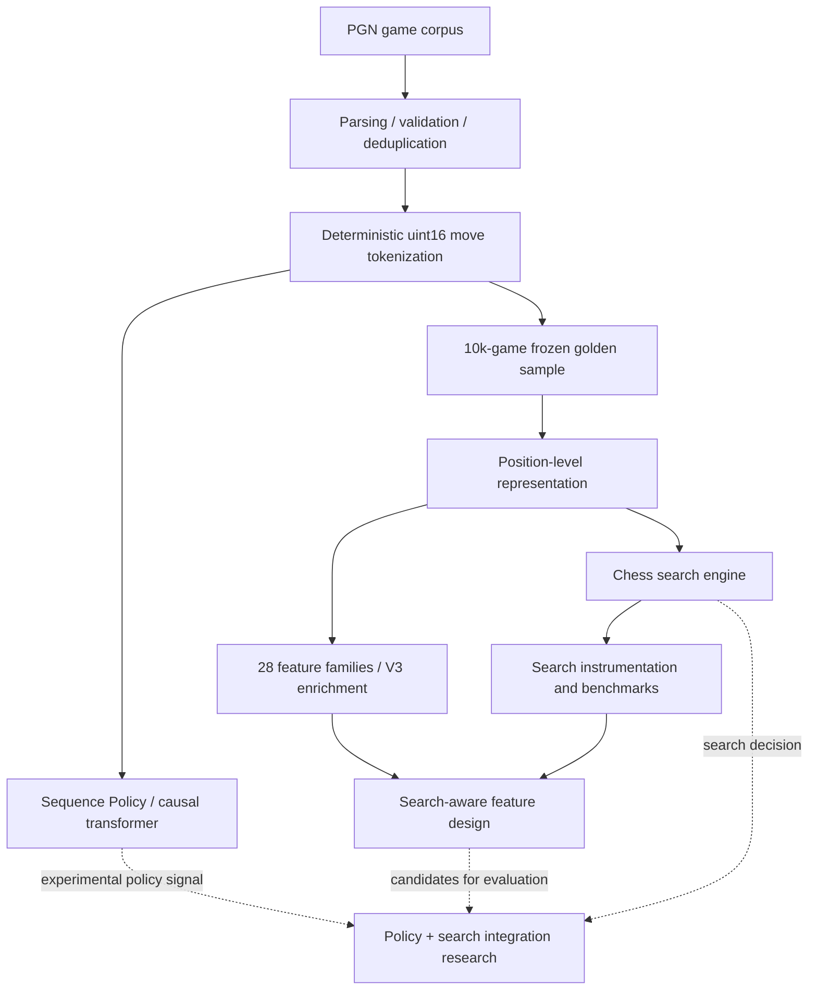

# Chess Alpha

### Building an experimental chess engine with deep learning, sequence modeling, classical search, and reproducible data engineering

**Chess Alpha** is an independent research and engineering project exploring how learned chess representations and move policies can work alongside a fully instrumented game-tree search engine. The project evolved through several complementary workstreams: large-scale PGN ingestion, deterministic move tokenization, transformer-based move prediction, neural policy/value experimentation, classical and selective search, position-level feature engineering, and rigorous testing.

This repository documents **an evolving experimental system**, not a claim to have built a production-strength, AlphaZero-equivalent engine. Neural policy, search, and data-enrichment components have different levels of integration and validation; the distinction is made explicit below.

> **Project status:** This README summarizes verifiable milestones documented through September 2026. It is a historical technical overview, not a live audit of the current working tree. Exact scripts, run commands, checkpoints, and artifacts should be matched to the code that is ultimately published.

## At a glance

| Area | Recorded milestone |
|---|---|
| Main game corpus | **1,000,000** selected games; approximately **81.2 million plies** |
| Initial PGN source | **4,471,784** games in the source PGN |
| Deterministic golden sample | **10,000** games, **808,611** plies |
| Golden position-level dataset | **818,611** rows (808,611 plies + 10,000 additional per-game rows) |
| Compact action representation | **16-bit** move IDs; **20,480** move/action slots, plus sequence special tokens |
| Position enrichment | **28/28** feature families completed over **818,611** rows |
| Enrichment consistency | **9/9** shards; `row_id` joins **100%**; **30/30** targeted tests |
| Sequence Policy FULL | **2,286** training steps; **74,536,785** tokens seen |
| Search Tree v1.1 | **458 passed**, **1 skipped**, **0 failed** in the recorded consolidated suite |
| Search observability | **450** executions across **90** positions × **5** configurations; no recorded illegal moves or position mutation |

**Terminology:** a *ply* is a single move by one player; a *game* consists of multiple plies. The 818,611-row golden/enrichment dataset is **not** the million-game corpus. Counts refer to distinct stages and should not be conflated.

## Why this project?

Chess is a useful laboratory for studying decision systems: the rules are deterministic, the legal-action space is constrained, tactical mistakes can be catastrophic, and evaluating decisions requires more than next-move prediction accuracy.

Chess Alpha pursues four complementary goals:

1. **Representation learning:** encode games and board positions in machine-readable forms while preserving move identity and legality.
2. **Statistical learning:** train models that estimate promising moves or position values from chess data.
3. **Structured decision-making:** search legal move trees with pruning, tactical extensions, caches, and explicit termination rules.
4. **Experimental reproducibility:** maintain frozen evaluation sets, deterministic sampling, recoverable long runs, automated tests, and regression gates.

## System overview



The dotted lines identify experimental integration paths. They do **not** mean every depicted connection was fully trained, deployed, or end-to-end validated.

## 1. Game ingestion and reproducible data preparation

The source PGN (`AJ-OTB-PGN-000.pgn`) was inspected as a read-only input. It contained **4,471,784** games and standard metadata such as event, date, ECO opening code, player Elo, result, and move count; some fields were incomplete. The pipeline filtered or replaced unusable candidates, including empty games, unsupported variants, missing results, and duplicates.

A deterministic sampler used **seed `20260803`** and constructed game identity from the **normalized starting FEN, variant, and complete UCI move sequence**, rather than move text alone. Candidate IDs and ordered consolidation made the output independent of worker completion order.

The tokenization implementation was isolated under `tokenization_v1/`, using `python-chess`, Windows-compatible multiprocessing with `spawn`, atomic writes, manifests, checkpoints, and restartable shards. A real interruption/resume test demonstrated that processing could restart without gaps or duplicated accepted games.

**The 10,000-game pilot:** 10,042 candidates inspected; 10,000 accepted; 42 rejected (26 empty, 14 duplicates, 1 missing result, 1 unsupported variant). It produced **808,611 plies**, averaged approximately **80.9 plies/game**, and ran at approximately **92.85 games/second** on the recorded two-worker configuration. A set of **25/25** tokenization tests passed at that stage.

The subsequent main corpus reached **1 million games** (approximately **81,244,568 plies**, based on the preserved project summary). The frozen 10k pilot was retained independently and was not overwritten.

## 2. Compact chess move tokenization

Each move was encoded as a 16-bit integer:

```text
action_id = (promotion_code << 12) | (from_square << 6) | to_square

from_square: 0–63
  to_square: 0–63
promotion_code: 0=none, 1=knight, 2=bishop, 3=rook, 4=queen
```

The encoding covers **5 × 64 × 64 = 20,480** potential IDs (not all correspond to legal moves in a given position). Castling, captures, and en passant are interpreted with the corresponding board state; special move semantics are not inferred from the ID alone. The sequence-model vocabulary was recorded as **20,483** entries when special tokens were included.

Round-trip tests covered ordinary moves, captures, both castlings for both sides, en passant, all promotion types, promotion captures, FEN starts, and reconstructed legal games.

## 3. Neural models and chess policy experiments

### Board-based policy/value research

The project explored a board-input neural policy/value line with **23 × 8 × 8** state planes, residual convolutional blocks, a transformer-based representation stage, and policy/value outputs. An experimental configuration recorded **six residual blocks (256 channels)** and **four transformer blocks (256-wide, eight attention heads)**. These are research-architecture notes; **the exact production wiring and checkpoints must be verified against the code before publishing model diagrams as definitive**.

In the **Chess Alpha v1.1** checkpoint evaluation, `control_epoch02` was selected as the operational reference and `balanced_epoch02` retained as an archived alternative. A controlled 100-game arena comparison against `epoch5` recorded **44 wins, 39 draws, 17 losses** (63.5% score), an estimated **+96.2 Elo** for the evaluated setup, and no illegal-move errors. The measured setup used a hybrid evaluation (material weight **0.25** / neural value weight **0.75**), depth **2**, and top-k **16**. This Elo estimate is **relative to the specific opponent and test settings**, not an absolute engine rating.

### Sequence Policy: causal move transformer

A separate model learns to predict subsequent move tokens from historical move sequences. The recorded training configuration used a causal transformer with **8 layers**, **384-dimensional model width**, **6 attention heads**, **1,536-dimensional feed-forward layers**, and **context length 256**, alongside RoPE positional representations.

The data pipeline produced training/development/test windows, a memory-efficient binary move-token file (`moves_uint16.bin`), collators, masked next-token targets, and a full checkpoint/recovery workflow. A gradient-accumulation issue was identified and corrected, with **113 tests passed and one skipped** in a recorded validation round.

The recovered `Sequence Policy FULL` checkpoint reached:

- `global_step = 2286`
- `tokens_seen = 74,536,785`
- Checkpoint SHA-256: `29f96d5a5343931e4cab71c6affa7628ab97240459a6792d7314f51901644804`

A frozen test evaluation was configured for **50,016 windows** and **4,118,551 prediction targets**, with hash checks protecting model and test artifacts. An available captured execution log shows successful initialization and partial processing, **not a confirmed completed final-test report**. Final held-out metrics should be taken from the original JSON reports rather than inferred from partial logs.

## 4. The search engine

`search_tree_v1` / Search Tree v1.1 evolved from a legal-move search foundation into a more advanced, tested search stack. The recorded components include:

- **Alpha–Beta pruning and Principal Variation Search (PVS)**.
- **Transposition tables (TT)** and principal-variation handling.
- **Iterative deepening** and structured stopping/budget controls.
- **Quiescence search** for tactical stability (an experiment used `max_qnodes = 20,000`).
- **Late Move Reductions (LMR)** and **null-move pruning** with safeguards.
- **DFPN/PNS-related proof-number search** for tactical/mate subproblems.
- Explicit **legality, repetition/cycle, mate, and terminal-position** checks.

The recorded consolidated Search Tree v1.1 suite finished with **458 passed, 1 skipped, 0 failed**. Search observability was developed as an **opt-in** mechanism: **90 positions × 5 configurations = 450 runs**, without observed mutation of game state, illegal moves, or execution errors in the captured benchmark.

This work measures correctness and search behavior. It does not, by itself, establish playing strength against external benchmark engines.

## 5. Position-level enrichment and search-aware research

The **Golden Dataset** was frozen and protected against accidental edits. It consists of **10,000 games**, **808,611 plies**, and **818,611 position-level rows**, partitioned into **nine shards**. Golden files underwent checksum and structural verification.

A separate **Tokenization Enrichment V3** pipeline completed **28/28 feature families**, processed all **818,611** positions, consolidated **9/9** shards, achieved a **100% `row_id` join**, and passed **30/30** targeted tests. The recorded output contained approximately **81 files / 298 MB**. A bitboard dtype inconsistency discovered during shard consolidation was fixed and covered by a regression test. The original Golden data remained byte-identical.

The next **search-aware feature engineering** design expanded from 10 to **40 signals**, with a subsequent discussion of approximately **60 candidate variables**. Proposed examples included move-order rank, PV membership, cutoffs, per-branch nodes, quiescence nodes, best-move stability across depths, depth-to-decision, LMR safety, and policy-vs-search disagreement. The design isolates these enrichments from the immutable Golden/V3 sources and joins candidate records using `row_id` and `move_id`.

**Important:** feature design and an approved implementation prompt are not equivalent to a verified completed, end-to-end 60-feature production dataset. Its final materialization and selection remain subject to repository/report inspection.

## 6. Experimental evaluation and negative results

An experimental **policy-prior calibration** with `λ = 0.15` on a **703-position** sample showed the following reported improvements in one phase:

| Metric | Before | After |
|---|---:|---:|
| Agreement@1 | 0.228 | 0.464 |
| Mean Reciprocal Rank (MRR) | 0.348 | 0.629 |
| Policy-correct / search-wrong rate | 0.306 | 0.041 |

That evaluation recorded **197 improvements versus 31 regressions**. However, a subsequent tactical gate **rejected** the proposed continuation: two mandatory mate defenses were missed and discovered-attack performance fell from **42.5% to 27.5%** on a 40-case set. There were no illegal moves or missed delivered mates in that gate. The rejected candidate was **not promoted** and the planned downstream arena stages were **not executed**.

This is a central engineering outcome: **aggregate policy agreement cannot replace tactical safety gates**.

## 7. Engineering principles

- **Reproducibility:** fixed seeds, hashes, golden test samples, recorded model and dataset versions.
- **Separation of concerns:** ingestion, tokenization, model training, search, observability, and enrichment are isolated workstreams.
- **Recoverability:** checkpoints, atomic writing, safe interruption, and resume after hardware/network disruption.
- **Testing:** move legality, round-trip serialization, FEN handling, parity, deterministic joins, state immutability, and search regression cases.
- **Evaluation discipline:** frozen test sets, differentiated development/held-out metrics, tactical gates, and documentation of negative findings.
- **Resource safety:** bounded parallel workers in shared environments and explicit separation of CPU-only and accelerator-based workloads.

## Technology

**Python · PyTorch · python-chess · NumPy · pandas · PyArrow/Parquet · Windows/PowerShell · multiprocessing · PGN/FEN/UCI · SHA-256**

**Stockfish** was used as a reference engine/data-generation dependency in parts of the research workflow; it is **not** being claimed as original Chess Alpha code. Some training and experiments ran locally and others were prepared for Google Colab. GPU usage varied by task; the search engine is not described as GPU-accelerated merely because GPU optimization was considered elsewhere.

## Recorded status and roadmap

| Workstream | Status in retained project evidence |
|---|---|
| 10k deterministic tokenization pilot | **Completed and validated** |
| Million-game move corpus | **Completed in project summary**; verify manifest before publishing raw counts as artifact proof |
| Golden position dataset | **Frozen / checksum-validated** |
| Enrichment V3, 28 families | **Completed and validated** |
| Sequence Policy FULL checkpoint (step 2286) | **Completed / recovered** |
| Sequence Policy final held-out evaluation | **Final metrics require report verification** |
| Chess Alpha v1.1 `control_epoch02` arena | **Completed in recorded controlled setup** |
| Search Tree v1.1 test suite | **Validated** |
| Search observability benchmark | **Validated in recorded benchmark** |
| 40–60 search-aware features | **Designed; final full-run status unverified** |
| Policy-prior Fase 6 | **Promising intermediate experiment** |
| Policy-prior Fase 7 | **Rejected on tactical regression gates** |
| Self-play / AlphaZero-style MCTS training loop | **Research direction, not a completed feature** |
| Transformer-XL and broader architecture alternatives | **Explored / proposed; not claimed as deployed** |

## Project documentation

- [Detailed technical write-up (Spanish)](docs/TECHNICAL_OVERVIEW_ES.md)
- [Milestones and experimental decisions](docs/PROJECT_MILESTONES.md)
- [Publication and verification checklist](PUBLICATION_CHECKLIST.md)

## Reproducing experiments

This documentation does **not** invent a one-command end-to-end runner. Reproducibility depends on obtaining the corresponding permitted PGN data, pinning dependencies, locating model checkpoints and dataset manifests, and following the scripts in each module.

For the recorded tokenization pipeline, a historical command pattern from inside `tokenization_v1/` was:

```powershell
python scripts/04_run_tokenization.py --config config/tokenization_config.json --test-name test_10000
```

and for continuation of an interrupted run:

```powershell
python scripts/04_run_tokenization.py --config config/tokenization_config.json --test-name NAME_OF_RUN --resume
```

**Do not rerun an immutable historical experiment under the same output name.** Use a new run identifier, and verify commands against the current source before execution.

## Limitations

No public claim is made here that the engine beats Stockfish, matches AlphaZero, has an externally certified Elo rating, or runs a completed self-play reinforcement-learning loop. Some results belong to **different experimental branches**, hardware configurations, and evaluation datasets; they are not interchangeable. The README should be updated when the actual repository tree and finalized reports are available.

## Attribution, data, and license

Chess Alpha is an independently developed experimental project. Input PGN datasets, reference-engine binaries, generated data artifacts, model checkpoints, and third-party libraries may carry separate rights or redistribution restrictions. **Do not commit datasets or binaries without checking their provenance and license.** Add an explicit repository software license only after choosing its terms.