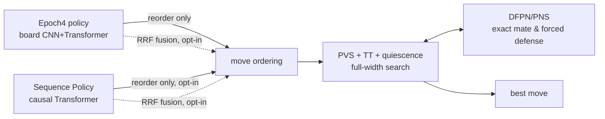

# Chess Alpha

### An experimental chess engine combining classical game-tree search, neural move policies and reproducible data engineering

**Chess Alpha** is an independent research and engineering project. It studies how learned move policies (a board-based CNN/Transformer and a causal move-sequence Transformer) can support an instrumented Alpha-Beta/PVS search engine **without ever taking tactical authority away from the search**.

This repository publishes the **source code** of the main components, together with the test suites and runnable examples. The project is experimental. It does not claim to be a production-strength or AlphaZero-equivalent engine. Each component's status is listed in [Status](#status).

## Why this project?

Chess is a useful laboratory for studying decision systems: the rules are deterministic, the legal-action space is constrained, tactical mistakes can be catastrophic, and evaluating decisions requires more than next-move prediction accuracy.

Chess Alpha pursues four complementary goals:

1. **Representation learning:** encode games and board positions in machine-readable forms while preserving move identity and legality.
2. **Statistical learning:** train models that estimate promising moves or position values from chess data.
3. **Structured decision-making:** search legal move trees with pruning, tactical extensions, caches, and explicit termination rules.
4. **Experimental reproducibility:** maintain frozen evaluation sets, deterministic sampling, recoverable long runs, automated tests, and regression gates.

## Quick start

```bash
python -m venv .venv
# Windows: .venv\Scripts\activate    Linux/macOS: source .venv/bin/activate
pip install -r requirements.txt                 # python-chess, numpy, pandas, pyarrow, pytest
pip install -r requirements-optional.txt        # optional: torch (CPU) for the neural components

python examples/search_demo.py                  # PVS + TT + quiescence, exact mate proof, forced defense
python examples/tokenization_features_demo.py   # uint16 move tokens + 28-family position features
python -m pytest -q -p no:cacheprovider         # all suites (see "Tests")
```

Both examples run on synthetic positions. They need no datasets, model weights or Stockfish.

## What is in this repository

| Path | Component |
|---|---|
| [`src/search_v1/`](src/search_v1) | **Search Tree V1**: the search engine (Negamax/Alpha-Beta, iterative deepening, transposition table, move ordering, quiescence, PVS, aspiration windows, null-move/LMR, DFPN/PNS exact mate proofs, forced-defense analysis, opt-in neural move-ordering providers and per-node observability). Depends only on `python-chess` |
| [`src/chess_alpha/`](src/chess_alpha) | 23×8×8 board encoding, `PolicyValueNetHybrid` (6 residual conv blocks plus 4 transformer blocks, 256 channels, 8 heads), the architecture of the selected **Epoch4** model, and the v1.1 training library |
| [`sequence_policy_v1/`](sequence_policy_v1) | **Sequence Policy**: a decoder-only causal Transformer over move tokens (RoPE, RMSNorm, SwiGLU, KV cache), with a deterministic resumable data pipeline, gradient accumulation, full-state checkpointing and n-gram baselines |
| [`src/sequence_policy_inference/`](src/sequence_policy_inference) | Read-only adapter that plugs a Sequence Policy checkpoint into the search as a move-ordering provider |
| [`tokenization_v1/`](tokenization_v1) | PGN → 16-bit `action_id` pipeline: deterministic sampling, parallel validation, atomic writes, shard checkpoints and resume, SHA-256 manifests, golden-dataset freezing, optional engine enrichment |
| [`tokenization_enrichment_v3/`](tokenization_enrichment_v3) | 28 position-feature families (attack maps, king safety, pawn structure, SEE, pins and skewers, threats, tactical motifs, …), with an anti-leakage registry |
| [`src/search/`](src/search) | Legacy minimax/alpha-beta engine that `search_v1` replaced. Kept for reference |
| [`examples/`](examples) | Runnable demos |
| [`docs/`](docs) | [Architecture](docs/ARCHITECTURE.md), [milestones](docs/PROJECT_MILESTONES.md), [Spanish technical overview](docs/TECHNICAL_OVERVIEW_ES.md) |

Source comments and docstrings are written in Spanish, the project's working language.

## Design principle: neural policies reorder, search decides



An earlier experiment let a policy prior influence search scores. It improved aggregate agreement metrics, but a tactical gate **rejected** it (see [Negative results](#negative-results)). Search Tree V1 was then built on a stricter contract: every neural provider returns an **exact permutation** of the moves the full-width search already generated. Tests enforce this contract. Mate and forced-defense proofs always come from DFPN or the search, never from a network.

DFPN results are explicitly three-valued: `PROVEN_MATE`, `PROVEN_NO_MATE` or `UNKNOWN`. Running out of budget never counts as a proof. The fifty-move rule is deliberately outside DFPN's formal proof scope. This is documented and covered by a test.

## Verified results

These figures come from the project's own machine-generated reports and manifests, which were checked during the preparation of this repository. They are historical results and were **not re-run** for this publication. Only the tests and examples listed under [Tests](#tests) were executed.

| Area | Result | Source of evidence |
|---|---|---|
| Source corpus | 4,471,784 games indexed in the source PGN | tokenization manifest |
| Main tokenized corpus | **1,000,000 games / 81,244,568 move tokens**, seed 20260803 | `tokenization_v1/outputs/full_1000000/manifest.json` |
| Golden sample | 10,000 games / 808,611 plies / 818,611 position rows, frozen with SHA-256 | tokenization + golden manifests |
| Move encoding | `action_id = (promo << 12) \| (from << 6) \| to`, 20,480 ids (uint16). Sequence vocabulary: 20,483 | `tokenizer.py`, `configs/model_base.yaml` |
| Sequence Policy FULL | 8 layers, d=384, 6 heads, FFN 1536, ctx 256. 2,286 steps, 74,536,785 tokens | checkpoint manifest |
| Sequence Policy, **frozen test** (read once) | 50,016 windows, 4,118,551 targets: **top-1 0.301, top-5 0.583, top-10 0.701, MRR 0.434**, ECE 0.014 | `sequence_policy_full_test_2286.json` (`FROZEN_TEST_FINAL`) |
| Sequence Policy, dev | top-1 0.301, top-10 0.700, MRR 0.434 (dev and frozen-test metrics agree closely) | dev report |
| Board policy/value v1.1 | `control_epoch02` vs `epoch5`: 100 games, 63.5 % score, **+96.2 Elo [44, 153]** (relative, depth 2, top-k 16, 25 % material / 75 % value). vs material-only baseline: 500 games, 71.1 %, +156.4 Elo [137, 177] | arena summaries |
| Epoch4 selection | Epoch4 vs `control_epoch02`: confirmatory arena of 500 games (250 colour-swapped pairs), **60.8 % score** for Epoch4, Elo CI entirely above 0, 0 errors and 0 illegal moves | arena-500 recommendation report |
| Search Tree V1 phase gates | Phases I–VIII each closed with an explicit gate. Phase VIII suite: **458 passed, 1 skipped, 0 failed** | phase closure reports |
| Search Tree V1, N=2000 A/B/C/D benchmark (depth 2) | 0 illegal moves across 11,988 searches, 0 errors. Epoch4 root-only ordering: 48.0 % tactical solve rate; fusion with Sequence Policy: 46.0 % → **fusion stays off by default** | Phase VIII closure report |
| Search observability | 90 positions × 5 configurations, 0 position mutations, 0 illegal moves. Null-move pruning: −27.3 % mean nodes vs baseline | observatory summary |
| V3 enrichment | 28/28 families over 818,611 rows, 9/9 shards, 100 % `row_id` join | V3 final report |

The populations are **not interchangeable**. The 1M-game corpus, the 10k golden sample, the 40k-position search dataset and the various arena and benchmark samples are different sets.

## Tests

Results of running the suites on this exported tree (Python 3.12, Windows, CPU, no datasets, no checkpoints, no Stockfish):

| Suite | Passed | Skipped | Failed | Skip reasons |
|---|---:|---:|---:|---|
| `tests/search_v1` | 460 (+299 subtests) | 9 | 0 | real Epoch4 / Sequence Policy checkpoints not distributed (9). `test_roundtrip.py` is not collected without the private dataset |
| `tokenization_v1/tests` | 160 | 12 | 0 | `STOCKFISH_PATH` not set |
| `sequence_policy_v1/tests` | 96 | 18 | 0 | private datasets or smoke checkpoint not present; one CUDA-only test |
| `tokenization_enrichment_v3/tests` | 27 | 0 | 0 | the golden-data smoke test is not collected without the data |
| **All (`python -m pytest` from the root)** | **743** | **39** | **0** | 3 min 40 s on CPU |

Each test runs with no datasets, no checkpoints and no Stockfish. `conftest.py` only leaves out the two modules that read private data, and it collects them automatically when that data is present.

Optional extras:
- **Stockfish** is not included and not needed for the tests or examples. Engine-enrichment tests run only when `STOCKFISH_PATH` points to a local binary.
- **GPU**: not required. Full Sequence Policy training was run on Google Colab GPUs. `sequence_policy_v1/configs/train_full_{t4,l4,a100}.yaml` hold the profiles.

## Status

| Component | Status |
|---|---|
| Search Tree V1, phases I–VI (search, TT, quiescence, PVS, pruning, DFPN) | **Implemented, tested, frozen** |
| Epoch4 as reorder-only provider (phase VII, `root_only` recommended) | **Implemented, tested**. The checkpoint is not published |
| Sequence Policy + RRF fusion in the search (phase VIII) | **Implemented, tested, opt-in / off by default**: no measured benefit at depth 2 |
| Sequence Policy training pipeline and model | **Implemented, tested**. The trained checkpoint is not published |
| Tokenization pipeline and golden dataset tooling | **Implemented, tested** |
| V3 position features (28 families) | **Implemented**, unit-tested on synthetic positions |
| Relative2D and "separate towers" architecture variants (`src/chess_alpha`) | **Experimental**, not selected |
| Search-aware enrichment (60 families, `search_enrichment_v1`) | **Experimental, not published**: a 100k-position gate ran, but the full production run was not completed |
| Search-parameter tuning (Random Search / Optuna, `tree_optimization_v1`) | **Experimental, not published** |
| Arena integration of `search_v1` | **Experimental, not published**: a 40-game pilot (search_v1 vs search_v1 + Epoch4) scored 50 % (36 draws), which is inconclusive |
| Self-play / MCTS / AlphaZero-style training loop | **Not implemented**. Research direction only |

## Negative results

- **Policy prior inside the search (rejected).** With λ = 0.15, a policy prior raised Agreement@1 from 0.228 to 0.464 on 703 opening positions. The tactical gate then **rejected** it: it missed 2 mandatory mate defenses, and its discovered-attack performance fell from 42.5 % to 27.5 % on 40 cases. It was never promoted. These two positions are now permanent regression fixtures (`tests/regression/forced_defense_critical.json`).
- **Fusion of the two policies** did not beat Epoch4 alone in the N=2000 benchmark. On unique defenses, fusion scored 73.5 % against 75.1 % for Epoch4 alone. It ships disabled.
- **Sequence Policy at search time** gave no benefit of its own at depth 2. It remains opt-in.

Aggregate policy agreement cannot replace tactical safety gates. That is the main engineering lesson of the project.

## What is not published, and why

- **Datasets** (source PGN collections, derived parquet/binary corpora, the 40k-position search dataset with Stockfish analysis): too large, and redistribution rights for every source have not been confirmed.
- **Model checkpoints** (Epoch4, Sequence Policy FULL): not published in this release.
- **Experiment drivers and raw reports** (about 170 numbered scripts, arena runs, notebooks, logs): tied to local data paths. Their results are summarised above.
- **Third-party material**: chess books and papers used as bibliography, and the Stockfish binary.

## Engineering principles

- **Reproducibility:** fixed seeds, hashes, golden test samples, recorded model and dataset versions.
- **Separation of concerns:** ingestion, tokenization, model training, search, observability, and enrichment are isolated workstreams.
- **Recoverability:** checkpoints, atomic writing, safe interruption, and resume after hardware/network disruption.
- **Testing:** move legality, round-trip serialization, FEN handling, parity, deterministic joins, state immutability, and search regression cases.
- **Evaluation discipline:** frozen test sets, differentiated development/held-out metrics, tactical gates, and documentation of negative findings.

## Limitations

No claim is made that the engine beats Stockfish, matches AlphaZero, has an externally certified Elo rating, or runs a self-play reinforcement-learning loop. Elo figures above are **relative** to specific opponents and settings. Results come from different experimental branches, hardware configurations and evaluation sets, and are not interchangeable.

## Reproducibility notes

- Every published source file is a byte-identical copy of the research tree. `EXPORT_MANIFEST.sha256` lists their hashes.
- The tokenization pipeline is deterministic (seed `20260803`), resumable (`--resume`) and writes SHA-256 manifests. **Do not reuse an existing run name**: write to a new output identifier.
- Long-running jobs (Stockfish enrichment, full training) need data that is not included. The code documents the expected inputs.

## Technology

Python 3.12 · python-chess · PyTorch · NumPy · pandas · PyArrow/Parquet · DuckDB · pytest · Windows multiprocessing (`spawn`) · Google Colab (GPU training) · Stockfish as an *external* reference engine through UCI. No Stockfish code is included.

## License

Copyright (C) 2026 Sebastian Baldoncini

Chess Alpha's own source code is free software: you can redistribute it and/or modify it under the terms of the **GNU General Public License as published by the Free Software Foundation, either version 3 of the License, or (at your option) any later version** (SPDX: `GPL-3.0-or-later`). It is distributed in the hope that it will be useful, but WITHOUT ANY WARRANTY; without even the implied warranty of MERCHANTABILITY or FITNESS FOR A PARTICULAR PURPOSE. See [`LICENSE`](LICENSE) for the full text.

The GPL was chosen because the code builds on [python-chess](https://github.com/niklasf/python-chess), which is GPL-3.0-or-later. This license covers only the code written for this project. Third-party libraries, Stockfish, game data and the unpublished model weights keep their own terms. See [`THIRD_PARTY_NOTICES.md`](THIRD_PARTY_NOTICES.md).
