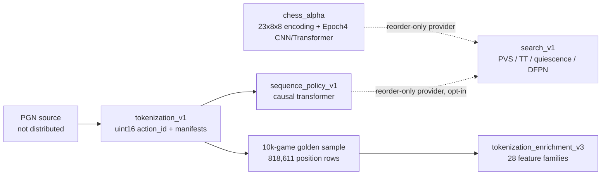

# Chess Alpha — Architecture of the published code

This document describes **only the code present in this repository**. Components that exist in the private research tree but are not published here are listed at the end.

Source comments and docstrings are in Spanish (the project's working language). Public documentation is in English.

## Repository layout

The directory layout of the original research tree was kept, so the
existing `sys.path` conventions in the code and tests work without edits.
Every source file is a byte-identical copy of the original; see
`EXPORT_MANIFEST.sha256`.

```text
chess-alpha/
├── src/
│   ├── search_v1/                  # Search Tree V1: the main search engine (python-chess only)
│   ├── sequence_policy_inference/  # Read-only adapter: Sequence Policy checkpoint -> search_v1
│   ├── chess_alpha/                # Board encoding, Epoch4 policy/value networks, v1.1 training library
│   └── search/                     # Legacy engine (minimax/alpha-beta), predecessor of search_v1
├── tests/
│   ├── search_v1/                  # Search Tree V1 test suite (unittest, run with pytest)
│   └── regression/                 # Critical forced-defense regression positions
├── sequence_policy_v1/
│   ├── src/sequence_policy/        # Causal move transformer, data pipeline, trainer, checkpointing
│   ├── tests/
│   └── configs/                    # Model sizes (tiny/base/large) and training profiles
├── tokenization_v1/
│   ├── scripts/                    # PGN -> uint16 action_id pipeline, position state, engine enrichment
│   ├── tests/
│   └── config/
├── tokenization_enrichment_v3/
│   ├── scripts/                    # 28 position-feature families (V3 enrichment)
│   ├── tests/
│   └── config/
└── examples/                       # Runnable demos on synthetic positions
```

## Data flow



## 1. `src/search_v1` — Search Tree V1

The package was built in eight gated phases. Each phase was frozen before the next one started, and later phases add features through opt-in parameters whose defaults keep the earlier behaviour.

| Phase | Modules | What it adds |
|---|---|---|
| I | `position.py`, `move.py`, `move_generator.py`, `terminal.py`, `repetition.py`, `static_evaluation.py`, `result.py` | Position wrapper over python-chess with an apply/undo stack; legal move generation; terminal detection; Polyglot-Zobrist repetition tracking; material-only static evaluation |
| II | `negamax.py`, `alpha_beta.py`, `iterative_deepening.py`, `mate_scores.py`, `search_context.py`, `search_limits.py`, `search_result.py`, `principal_variation.py` | Reference Negamax (used as an oracle), Alpha-Beta, iterative deepening with node/time limits. Mate scores use `MATE_SCORE - ply_from_root` |
| III | `transposition_table.py`, `move_ordering.py` | Direct-mapped TT that always compares the full 64-bit key, with mate-score normalisation (`score_to_tt` / `score_from_tt`). Move ordering: hash move > immediate mate > promotions > MVV-LVA > killers > countermove > history |
| IV | `quiescence.py`, `quiescence_limits.py`, `tactical_moves.py`, `quiescence_result.py` | Quiescence search with stand-pat, bounded check extensions and a global qnode ceiling |
| V | `pvs.py`, `aspiration.py`, `pruning_config.py` | PVS and aspiration windows (exact). Null-move pruning and LMR are opt-in heuristic prunings. Futility and razoring are implemented but not enabled by default |
| VI | `dfpn*.py`, `proof_status.py`, `mate_search.py`, `forced_defense.py`, `proof_verifier.py` | Proof-Number Search (a DFPN-equivalent variant with an explicit tree) for exact forced mates. Results are always one of PROVEN_MATE, PROVEN_NO_MATE(_WITHIN_BOUND) or UNKNOWN. A budget-exhausted search is never reported as "no mate". Also: forced-defense classification, an independent exhaustive oracle to verify proofs, and `proof_mode`, which turns off every heuristic pruning |
| VII | `epoch4_provider.py` | Epoch4 policy as a **reorder-only** move-ordering provider. Scopes: `all_nodes` or `root_only` |
| VIII | `sequence_policy_provider.py`, `candidate_fusion.py`, `prior_mode.py` | Sequence Policy provider (`root_only`) and Reciprocal Rank Fusion (k=60) of both policies over UCI moves |
| Observability | `observer.py` | Opt-in per-node tracing. With `observer=None` behaviour is unchanged (tested) |

**Central invariant:** neural providers return an exact permutation of the moves PVS already generated. They cannot add, remove or restrict moves, so tactical authority stays with the full-width search. The same pure-function contract is enforced by tests for `reorder_with_epoch4`, `reorder_with_sequence_policy` and `reorder_with_fusion`.

**Four separate caches:** the search TT, the DFPN table, the Epoch4 cache and the Sequence Policy cache (keyed by Zobrist key plus history). They never share entries.

**Documented scope limit:** DFPN deliberately leaves the fifty-move rule out of its formal proof scope. An earlier version cached proofs without `halfmove_clock` in the key, which was unsafe. This is covered by `test_dfpn.py::test_fifty_move_rule_deliberately_out_of_scope`.

`search_v1` never imports `chess_alpha` or `sequence_policy` itself. Neural evaluators are built elsewhere and injected as duck-typed objects that expose `.predict(...)`.

## 2. `src/chess_alpha` — board encoding and Epoch4 networks

- `encoding.py`: `board_to_tensor()` encodes a board as a `(23, 8, 8)` float32 tensor.
- `model_hybrid.py`: `PolicyValueNetHybrid`. A conv stem feeds 6 residual blocks (256 channels), then 4 transformer blocks over the 64 squares (8 heads), then policy and value heads. **Epoch4**, the selected checkpoint, uses this architecture. The checkpoint itself is not published.
- `model_hybrid_relative2d.py` and `model_hybrid_separate_towers.py`: experimental architecture variants (see "Status").
- `inference.py`: `HybridNeuralEvaluator`, which loads a checkpoint and a policy vocabulary (1,868 move indices) and returns `(probs_by_uci, value)`.
- `train_*.py`: the v1.1 training library, with config, dataset mixing, hard/soft policy targets, configurable losses, optimizer/scheduler/EMA and a training loop.
- `search_tree_dataset/`: helpers for building the 40k-position search dataset (atomic I/O, identities, a Stockfish MultiPV wrapper).
- `config.py`: repository-relative paths only. Most of them point to data that is **not** published. Importing it creates the expected empty `data/`, `models/`, `logs/` and `reports/` directories at the repository root. `.gitignore` excludes them.

## 3. `sequence_policy_v1` — Sequence Policy (causal move transformer)

- `model.py`: `CausalMoveTransformer`, a decoder-only model with RoPE, RMSNorm, SwiGLU, tied embeddings and a KV cache.
- The BASE configuration (`configs/model_base.yaml`) has 8 layers, d_model 384, 6 heads, FFN 1536, context 256 and a vocabulary of 20,483 tokens (20,480 action ids plus special tokens).
- Data pipeline: memory-mapped window reader (`dataset_reader.py`), causal windows with overlap and a loss mask (`sequence_windows.py`), a deterministic resumable sampler (`sampler.py`), a bucketing collator, and legal-move masking at evaluation time.
- Training: `trainer.py`, `full_checkpoint.py` (full state: model, optimizer, scheduler, scaler, sampler, RNG), `gpu_profile.py` (precision policy for T4/L4/A100), and gradient accumulation. The accumulation logic was fixed after a real bug and is covered by tests.
- `statistical_baseline.py`: n-gram baselines B0–B4 used as reference points.

## 4. `tokenization_v1` — PGN tokenization pipeline

- `tokenizer.py`: `action_id = (promo << 12) | (from << 6) | to`, with 5 × 64 × 64 = 20,480 ids that fit in uint16.
- `game_parser.py`: per-game PGN parsing from byte offsets. Headers and movetext are parsed by hand, every move is validated with python-chess, the parser does not rely on `PlyCount`, and failures come back as serializable results rather than exceptions, so one bad game cannot crash the worker pool.
- `04_run_tokenization.py`: deterministic sampling (seed 20260803), parallel validation on Windows `spawn`, atomic writes, shard checkpoints and `--resume`.
- `position_state.py`, `legal_moves.py`, `history.py`, `repetition.py`, `value_target.py`: per-position state reconstruction and targets.
- `stockfish_enrichment.py`, `engine_cache.py` (SQLite), `engine_records.py`: optional engine enrichment. A **local** Stockfish binary is called through python-chess UCI. No Stockfish code is included.
- `golden_lock.py`, `shard_integrity.py`, `18_freeze_golden_dataset.py`, `20_validate_golden_dataset.py`: freezing and SHA-256 integrity checks.

## 5. `tokenization_enrichment_v3` — position features

`scripts/feature_registry.py` defines 28 feature families and classifies each one by origin, as an anti-leakage registry:

- **Board-derived, input-safe (18):** attack maps, attack density, hanging pieces, mobility, king safety, pawn structure, passed pawns, pawn majorities, outposts, pins, skewers/x-rays, overloaded pieces, SEE, threats, tactical motifs, space, piece activity, centre structure.
- **History-derived, input-safe (1):** move sequences.
- **Engine-derived, not input-safe (7):** evaluation trajectory, policy entropy, decision margins, WDL, mate labels, tablebase, human-engine agreement.
- **Future-dependent, not input-safe (1):** distance to the terminal position.
- **Game-derived, not input-safe (1):** human consensus.

`position_features.compute_all_position_features(fen, config)` computes the board-derived families from a FEN. The engine-derived families need a local Stockfish binary (or Syzygy tablebases for `tablebase`), neither of which is included.

## Status of published components

| Component | Status |
|---|---|
| `search_v1` phases I–VI | Implemented, tested and frozen |
| `search_v1` Epoch4 provider (phase VII) | Implemented and tested with fake evaluators. Tests with the real checkpoint are skipped without it |
| `search_v1` Sequence Policy + fusion (phase VIII) | Implemented and tested. Off by default (`enabled=False`) because the recorded N=2000 benchmark showed no benefit |
| `search_v1/observer.py` | Implemented and tested (opt-in) |
| `sequence_policy_v1` | Implemented and tested. The trained checkpoint is not published |
| `tokenization_v1` | Implemented and tested. Tests run on synthetic data |
| `tokenization_enrichment_v3` | Implemented. Unit tests run on synthetic positions. The golden-data smoke test needs data that is not published |
| `chess_alpha` v1.1 training library | Implemented. Its tests and drivers are not part of this export |
| `model_hybrid_relative2d.py`, `model_hybrid_separate_towers.py` | Experimental branches. Not selected as the operational model |
| `src/search` (legacy engine) | Superseded by `search_v1`. Kept for reference |

## Not published (exists in the private research tree)

These are left out because they need private data, are experiment drivers tied to local paths, or are still under review: about 170 numbered experiment/report drivers (`src/NN_*.py`), the Arena (`src/arena`), `search_enrichment_v1` (60 search-aware feature families), `tree_optimization_v1` (Random Search/Optuna tuning of search parameters), notebooks, Colab bundles (byte-identical duplicates of `sequence_policy_v1/src`), datasets, checkpoints, logs and raw reports.
